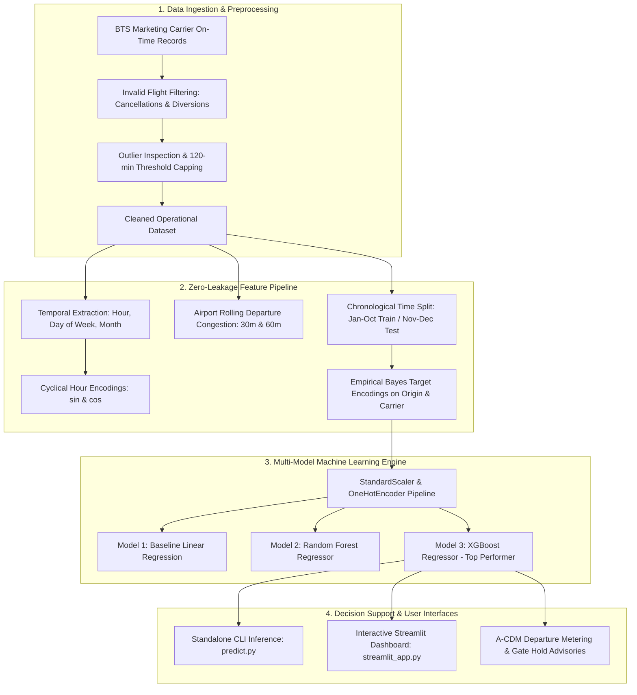

# System Architecture & Technical Specifications

**Project:** Aviation Taxi-Out Time Prediction & Surface Congestion Analytics  
**Coursework:** JNTU Hyderabad — Aviation Data Science & Operations Research  
**Student ID:** `2606MGAIL130`  
**Framework:** Airport Collaborative Decision Making (A-CDM) & Surface Trajectory-Based Operations (TBO)  

---

## 1. High-Level Operational Architecture

The Taxi-Out Prediction pipeline forecasts surface elapsed ground time ($\text{TAXI\_OUT}$) between gate pushback ($\text{DEP\_TIME}$) and takeoff roll ($\text{WHEELS\_OFF}$). In accordance with Federal Aviation Administration (FAA) and Eurocontrol A-CDM standards, the system operates as a decision-support layer for airline dispatchers and tower coordinators.



---


### 1.1 AI Analyst Query Routing

The AI Analyst uses a deterministic calculation layer before workbook lookup and document retrieval. This prevents numeric questions from being answered by an unrelated README, report, or parameter description.

```text
User question
    -> spelling and phrase normalization
    -> live-data calculation router
       - monthly taxi-out statistics and requested percentiles
       - airport, carrier, route, and hour taxi-out aggregations
       - cleaned-record shares for an explicitly named airport or carrier
       - dashboard-default taxi-out interpretation for unscoped average-time questions
    -> workbook lookup for curated factual answers
    -> TF-IDF document retrieval for explanatory questions
```

The default taxi-out interpretation is applied only when the question asks for a time statistic and does not contain a competing metric such as departure delay, distance, flight duration, or model error. This keeps the dashboard context useful without allowing unrelated questions to be silently reinterpreted.

## 2. Pipeline Components

### 2.1 Preprocessing & Quality Assurance (`src/data_preprocessing.py`)
- **Invalid Records Removal:**
  - Cancelled departures ($\text{CANCELLED} = 1$): Aircraft never pushed back.
  - Diverted departures ($\text{DIVERTED} = 1$): Irregular operations.
  - Non-positive taxi duration ($\text{TAXI\_OUT} \le 0$ or $\text{NaN}$).
- **Outlier Capping Protocol:**
  - Threshold set at $120.0\text{ minutes}$ based on percentile analysis ($99.9\text{th percentile} \approx 118.2\text{ min}$).
  - Observations $> 120\text{ min}$ reflect non-modeled disruptions (ground de-icing holds, maintenance turnbacks).

### 2.2 Feature Engineering Engine (`src/feature_engineering.py`)
- **Diurnal Cyclical Encoding:**
  $$\text{Sin\_Hour} = \sin\left(\frac{2\pi \cdot \text{Hour}}{24}\right), \quad \text{Cos\_Hour} = \cos\left(\frac{2\pi \cdot \text{Hour}}{24}\right)$$
- **Airfield Congestion Index:**
  - `CONGESTION_1H`: Concurrent flights pushing back from the same origin within $[t - 60\text{m}, t]$.
  - `CONGESTION_30M`: Concurrent flights pushing back within $[t - 30\text{m}, t]$.
- **Leak-Free Smoothed Target Encoding:**
  $$\hat{\mu}_{\text{smoothed}} = \frac{n \cdot \bar{y} + m \cdot \mu_{\text{global}}}{n + m}$$
  where $m = 10.0$ is the Bayesian smoothing parameter, computed exclusively on Months 1–10.

### 2.3 Model Execution & Serialization (`src/train_models.py`)
- Unified `scikit-learn` ColumnTransformer pipelines serialized via `joblib`:
  - `models/linear_regression_baseline.joblib`
  - `models/random_forest_regressor.joblib`
  - `models/xgboost_regressor.joblib`
- Encodings persisted to `models/target_encoders.json`.

---

## 3. Operational Performance Benchmarks (Nov–Dec Out-of-Time Test Set)

| Metric | Linear Regression | Random Forest | XGBoost Regressor |
| :--- | :---: | :---: | :---: |
| **Mean Absolute Error (MAE)** | 4.17 min | 4.04 min | **3.88 min** |
| **Root Mean Squared Error (RMSE)** | 10.04 min | 10.00 min | **9.89 min** |
| **$R^2$ Score** | 0.0166 | 0.0239 | **0.0452** |
| **Operational Accuracy ($\pm 3$ min)** | 54.6% | 57.5% | **58.8%** |
| **Operational Accuracy ($\pm 5$ min)** | 78.9% | 82.6% | **84.9%** |

---

## 4. Hardware & Software Requirements

- **Runtime Environment:** Python 3.10+ (tested on Python 3.11 Windows 64-bit).
- **Core Dependencies:** `pandas >= 2.0`, `scikit-learn >= 1.3`, `xgboost >= 2.0`, `streamlit >= 1.30`, `plotly >= 5.18`.
- **Inference Latency:** $< 15\text{ ms}$ per single-flight prediction on standard CPU.
